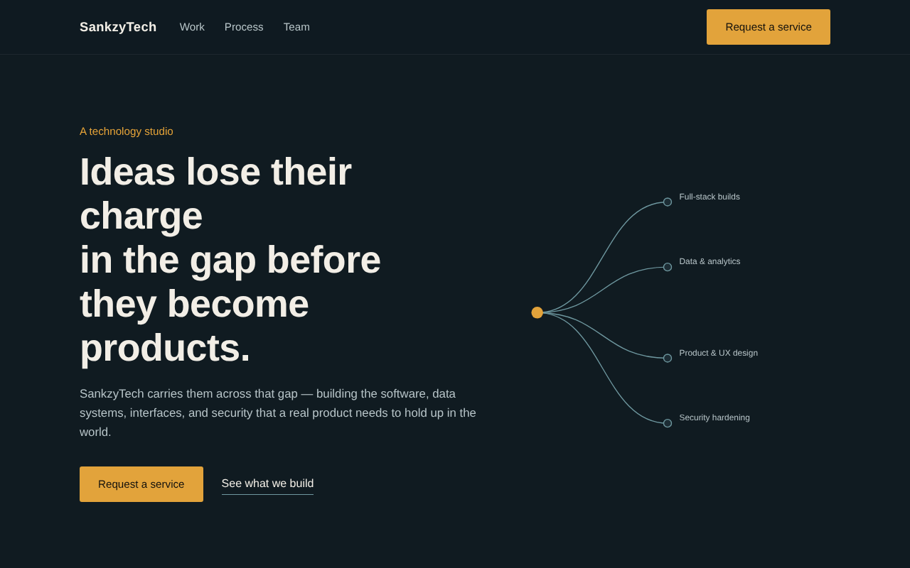
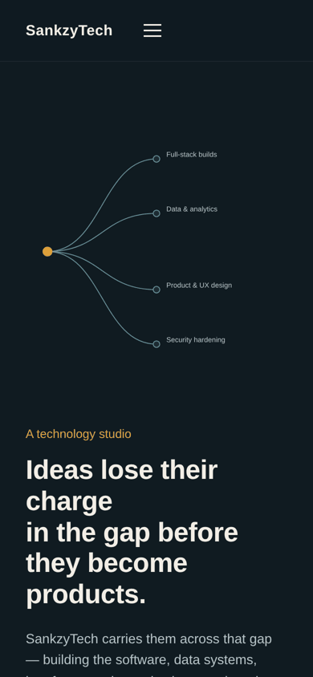

# SankzyTech: Landing Page, Contact System and Content Manager

A responsive landing page for a fictional technology studio, with a working contact form that saves inquiries to a database and a password-protected page for managing site content. It was built for the VOLTIX Full Stack Development Internship 2026 and covers three tasks:

1. **Task 1:** the public landing page
2. **Task 2:** a contact and inquiry system (form, validation, API, database)
3. **Task 3:** an internal content management page with login

**Live site:** https://sankzytech.vercel.app
**API:** https://sankzytech.onrender.com (free tier, the first request after a quiet period can take 30 to 50 seconds)





## Built with

- HTML, CSS and vanilla JavaScript for the frontend (no framework, no build step)
- Node.js and Express for the API
- MongoDB (Atlas) with Mongoose for storage
- JSON Web Tokens (`jsonwebtoken`) for admin login
- Vercel for the frontend and Render for the backend

## Features

- Responsive layout with a mobile menu, an animated circuit-style hero diagram, and `prefers-reduced-motion` support
- Contact form that validates input in the browser and again on the server, then stores the inquiry in MongoDB
- Admin page (`/admin.html`, not linked from the public site) to add, view, edit and delete content items
- Admin login that exchanges a password for a signed token that expires after 12 hours
- Layered backend: routes, middleware, controllers and models, each with one job

## Project structure

```text
VOLTIX-Internships-Program-2026/
├── index.html       # Public site: structure and content, including the contact form
├── style.css        # Design tokens, layout and component styles
├── script.js        # Mobile menu and contact form submission
├── admin.html       # Content manager page
├── admin.css        # Admin styles (reuses tokens from style.css)
├── admin.js         # Login gate and content create/read/update/delete
├── docs/            # README screenshots
├── backend/         # Express + MongoDB API, see backend/README.md
└── README.md
```

## Run it locally

**Frontend.** It is static, so open `index.html` in a browser, or serve the folder:

```bash
npx serve .
```

The forms call the deployed API by default. To use your own backend, change `API_BASE_URL` at the top of `script.js` and `admin.js` (for example to `http://localhost:4000`).

**Backend.** You need Node.js and a free MongoDB Atlas database:

```bash
cd backend
npm install
cp .env.example .env    # then fill in the values below
npm run dev
```

| Variable          | What it is                                                   |
| ----------------- | ------------------------------------------------------------ |
| `MONGODB_URI`     | Connection string from MongoDB Atlas                         |
| `ADMIN_KEY`       | The password used to log in to `admin.html`                  |
| `JWT_SECRET`      | A different long random string, used to sign login tokens    |
| `PORT`            | Port for the server (default `4000`)                         |
| `ALLOWED_ORIGINS` | Comma-separated list of sites allowed to call the API (CORS) |

Never commit `.env`. It is already in `backend/.gitignore`.

## API at a glance

| Method | Path               | Auth   | Purpose                                  |
| ------ | ------------------ | ------ | ---------------------------------------- |
| POST   | `/api/contact`     | none   | Validate and save a contact inquiry      |
| POST   | `/api/auth/login`  | none   | Exchange `ADMIN_KEY` for a 12-hour token |
| GET    | `/api/content`     | Bearer | List content items, newest first         |
| POST   | `/api/content`     | Bearer | Create a content item                    |
| PUT    | `/api/content/:id` | Bearer | Update a content item                    |
| DELETE | `/api/content/:id` | Bearer | Delete a content item                    |

Request and response examples are in [`backend/README.md`](backend/README.md).

## Design decisions

- **Colour tokens** are defined once in `:root` in `style.css` and reused through CSS variables, so the palette changes in one place.
- **Two typefaces:** Space Grotesk for headings and IBM Plex Sans for body text, loaded from Google Fonts.
- **Layout:** an asymmetric hero (text beside a circuit-style diagram) and alternating left and right service sections, to avoid a generic template look.
- **Motion:** one animated moment (the circuit lines drawing in on load), turned off for visitors who ask for reduced motion.
- **One job per file:** markup in HTML, styling in CSS, behaviour in JavaScript. On the backend, validation lives in middleware so rules can change without touching controllers.

## Deployment

- **Frontend:** any static host works. It is deployed on Vercel, and it also works on Netlify or GitHub Pages.
- **Backend:** deployed separately on Render, because Vercel runs serverless functions and this is a long-running Express server. Set the Root Directory to `backend`, the build command to `npm install`, the start command to `npm start`, and add the four environment variables above. Full steps are in [`backend/README.md`](backend/README.md).

## Known limitations

- There is one shared admin password, not per-user accounts.
- The login endpoint has no rate limiting yet, so repeated guesses are not slowed down.
- The public page shows static copy. It does not yet read content items from `/api/content`.
- There are no automated tests yet.

## Next steps

- Show content items from the API on the public page
- Add rate limiting to `/api/auth/login`
- Replace the shared admin key with per-user accounts if more than one person needs access
- Add automated tests for the validation middleware and the API routes
- Add meta description and Open Graph tags to `index.html` for better search and sharing previews
